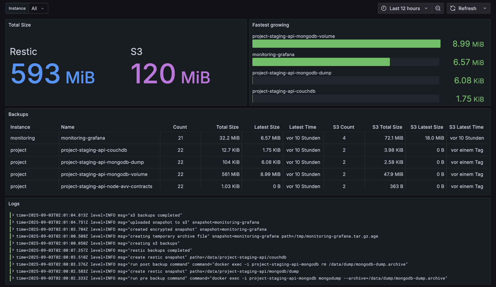

# AutoRestic

Schedule and monitor Restic backups and S3 snapshots with client-side encryption and WORM (Write Once Read Many) protection.

## Getting Started

1. Create an s3 bucket with retention mode (governance) and lifecycle policies: [see terraform module](terraform)
2. Create a `config.yml`, `.env` and `docker-compose.yml`: Examples below
3. Configure your backup directories and pre/post commands in your `config.yml`
4. Run `docker compose up`

## Limitations

- ⚠️ Docker Desktop is not supported (restic will complain about file reads despite correct mounts)

## Configuration

Configuration can be passed through environment variables and a config.yml. It's recommended to use `.env` for sensitive values (e.g. credentials) and `config.yml` for all other values.

### Example

.env (all variables are required)

```env
RESTIC_PASSWORD=
S3_ACCESS_KEY=
S3_SECRET_KEY=
S3_ENDPOINT=
S3_BUCKET=
S3_PASSPHRASE=
```

Optional: `API_TOKEN=` (at least 16 characters, e.g. `openssl rand -hex 32`) to trigger jobs remotely, see [Trigger jobs](#trigger-jobs).

config.yml (all variables are shown with defaults and are optional)

```yaml
logging:
  level: info # one of (debug, info, warn, error)
  format: text # one of (text, json, console)

restic:
  repository: /repository
  keep_daily: 7
  keep_weekly: 4
  keep_monthly: 3
  timeout: 0 # Abort long-running restic commands, e.g. 6h. Default = 0 (no timeout)

cron:
  metrics: "0 0 0 * * *" # Every day at 00:00
  backup: "0 0 2 * * *" # Every day at 02:00
  s3: "0 1 2 * * 0" # Every Sunday 02:01
  check: "0 2 2 * * 0" # Every Sunday 02:01
  prune: "0 3 2 * * 0" # Every Sunday 02:03

s3:
  secure: true # Use HTTPS, set to false for a plain-HTTP endpoint (e.g. a local MinIO). Default = true
  retries: 2 # Additional attempts. Default = 2
  timeout: 0 # Abort a single upload attempt, e.g. 2h. Default = 0 (no timeout)

api:
  listen: "" # Address of the API to trigger jobs, e.g. ":2113". Requires API_TOKEN. Default = "" (disabled)

backups:
  - path: /data/mongodb-dump
    name: mongodb-dump # required, only letters, digits, ".", "_" and "-"
    pre_command: "docker exec -i mongodb mongodump --archive=/mongodb-dump/mongodb-dump.archive"
    post_command: "docker exec -i mongodb rm /mongodb-dump/mongodb-dump.archive"
    exclude: ".DS_Store"
    exclude_file: "/config/exclude.txt"
    s3_retries: 1 # Overwrite the global retries if necessary
    command_timeout: 0 # Kill pre/post commands, e.g. 30m. Default = 0 (no timeout)
```

### Timeouts

Timeouts are optional and disabled by default. Set them to make sure a hanging command can't block all later jobs, since jobs run one at a time. Values are durations with a unit (e.g. `30m`, `6h`). They can also be set via `RESTIC_TIMEOUT` and `S3_TIMEOUT`.

- `restic.timeout` applies to `backup`, `restore`, `dump`, `check`, `forget --prune` and `stats`. On timeout restic receives SIGINT so it can release its repository lock, and is killed after one minute if it hasn't exited.
- `s3.timeout` applies to each upload attempt. A timed-out attempt counts as a failure, so `s3.retries` applies. The archive is streamed from `restic dump` while uploading, so an attempt is limited by both `s3.timeout` and `restic.timeout`.
- `backups[].command_timeout` applies to `pre_command` and `post_command`. On timeout the whole process group is killed.

Short metadata calls always use a fixed timeout: 5 minutes for `restic snapshots` and `restic init`, 1 minute for S3 bucket checks and listings.

docker-compose.yml

```yaml
services:
  auto-restic:
    image: ghcr.io/korbiniankuhn/auto-restic:1.0.0
    container_name: auto-restic
    ports:
      - 127.0.0.1:2112:2112
    volumes:
      - ./.env:/auto-restic/.env:ro
      - ./config.yml:/auto-restic/config.yml:ro
      - ./data:/data
      - ./restic:/repository
      - ./restore:/restore
      - /var/run/docker.sock:/var/run/docker.sock # only required if you run docker commands for pre-post backup scripts
```

## CLI

A CLI is provided to list, remove, and restore backups (restic or S3), to unlock the restic repository and to trigger jobs on the server. The CLI uses the same config as the server (e.g. for access keys, secrets).

Connect to a running container

```bash
docker exec -it auto-restic sh
```

or start a temporary one:

```bash
docker compose run --entrypoint "/bin/sh" auto-restic
```

| Command                                                                | Description                                 |
| ---------------------------------------------------------------------- | ------------------------------------------- |
| auto-restic restic ls                                                  | List all local backups and snapshots        |
| auto-restic restic rm --name ""                                        | Remove all snapshots of a backup            |
| auto-restic restic restore --snapshot-id "" --mount-path ""            | Restore snapshot to a local directory       |
| auto-restic restic unlock [--remove-all]                               | Remove stale (or all) repository locks      |
| auto-restic s3 ls                                                      | List all S3 backups and versions            |
| auto-restic s3 rm --object-key "" --version-id ""                      | Remove S3 object with specific version      |
| auto-restic s3 restore --object-key "" --version-id "" --mount-path "" | Restore object version to a local directory |
| auto-restic run backup\|s3\|check\|prune [--server ""] [--token ""]     | Trigger a job on the server                 |

If the container was killed while restic held a lock (e.g. during a backup), following runs fail with `repository is already locked`. `auto-restic restic unlock` removes locks that haven't been refreshed for 30 minutes. To remove them right away use `--remove-all`, but only while no backup is running.

### Trigger jobs

`auto-restic run <backup|s3|check|prune>` asks the running server to run a job now, e.g. before maintenance. The server queues it like a scheduled run: it waits for a running job to finish, and records the same logs and metrics. The command returns once the job is queued.

The API is disabled by default. Enable it with `api.listen` (or `API_LISTEN`) and `API_TOKEN`:

```yaml
api:
  listen: ":2113"
```

```yaml
services:
  auto-restic:
    ports:
      - 127.0.0.1:2113:2113
```

The CLI reads the server URL from `--server` or `API_URL` (default `http://localhost:2113`) and the token from `--token` or `API_TOKEN`. It only needs these two values, so it also works from another machine:

```bash
# inside the container
docker exec auto-restic auto-restic run backup

# from another machine
API_URL=https://backup.example.com API_TOKEN=... auto-restic run s3
```

The API serves plain HTTP. To reach it over the network, put it behind a reverse proxy with TLS or use an SSH tunnel instead of exposing the port directly.

### S3 (Disaster Recovery)

S3 snapshots are encrypted with age using the provided passphrase. To decrypt a backup without using the CLI run:

```bash
age -d -o your-backup-name.tar.gz your-backup-name.tar.gz.age
# Enter your passphrase
```

## Monitoring

Prometheus metrics are exported under [localhost:2112/metrics](localhost:2112/metrics)

```yaml
# HELP backup_restic_snapshot_count Total number of restic snapshots per backup name
# TYPE backup_restic_snapshot_count gauge
backup_restic_snapshot_count{backup_name="mongodb-dump"} 2
backup_restic_snapshot_count{backup_name="production"} 7
backup_restic_snapshot_count{backup_name="staging"} 5
# HELP backup_restic_snapshot_errors_total Total number of errors creating restic snapshots per backup name
# TYPE backup_restic_snapshot_errors_total counter
backup_restic_snapshot_errors_total{backup_name="mongodb-dump"} 1
# HELP backup_restic_snapshot_latest_duration_seconds Duration in seconds of the latest restic snapshot per backup name
# TYPE backup_restic_snapshot_latest_duration_seconds gauge
backup_restic_snapshot_latest_duration_seconds{backup_name="production"} 0.78878625
backup_restic_snapshot_latest_duration_seconds{backup_name="staging"} 0.777218083
# HELP backup_restic_snapshot_latest_size_bytes Size in bytes of the latest restic snapshot per backup name
# TYPE backup_restic_snapshot_latest_size_bytes gauge
backup_restic_snapshot_latest_size_bytes{backup_name="mongodb-dump"} 1240
backup_restic_snapshot_latest_size_bytes{backup_name="production"} 0
backup_restic_snapshot_latest_size_bytes{backup_name="staging"} 0
# HELP backup_restic_snapshot_latest_timestamp_seconds Unix timestamp of the latest restic snapshot per backup name
# TYPE backup_restic_snapshot_latest_timestamp_seconds gauge
backup_restic_snapshot_latest_timestamp_seconds{backup_name="mongodb-dump"} 1.749808336e+09
backup_restic_snapshot_latest_timestamp_seconds{backup_name="production"} 1.75707894e+09
backup_restic_snapshot_latest_timestamp_seconds{backup_name="staging"} 1.75707894e+09
# HELP backup_restic_snapshot_total_size_bytes Total size in bytes of all restic snapshots per backup name
# TYPE backup_restic_snapshot_total_size_bytes gauge
backup_restic_snapshot_total_size_bytes{backup_name="mongodb-dump"} 2527
backup_restic_snapshot_total_size_bytes{backup_name="production"} 3244
backup_restic_snapshot_total_size_bytes{backup_name="staging"} 2172
# HELP backup_s3_snapshot_count Total number of S3 snapshots per backup name
# TYPE backup_s3_snapshot_count gauge
backup_s3_snapshot_count{backup_name="mongodb-dump"} 7
backup_s3_snapshot_count{backup_name="production"} 8
backup_s3_snapshot_count{backup_name="staging"} 8
# HELP backup_s3_snapshot_latest_size_bytes Size in bytes of the latest S3 snapshot dump per backup name
# TYPE backup_s3_snapshot_latest_size_bytes gauge
backup_s3_snapshot_latest_size_bytes{backup_name="mongodb-dump"} 711
backup_s3_snapshot_latest_size_bytes{backup_name="production"} 395
backup_s3_snapshot_latest_size_bytes{backup_name="staging"} 389
# HELP backup_s3_snapshot_latest_timestamp_seconds Unix timestamp of the latest S3 snapshot dump per backup name
# TYPE backup_s3_snapshot_latest_timestamp_seconds gauge
backup_s3_snapshot_latest_timestamp_seconds{backup_name="mongodb-dump"} 1.75707841e+09
backup_s3_snapshot_latest_timestamp_seconds{backup_name="production"} 1.757078405e+09
backup_s3_snapshot_latest_timestamp_seconds{backup_name="staging"} 1.757078407e+09
# HELP backup_s3_snapshot_total_size_bytes Total size in bytes of all S3 snapshots per backup name
# TYPE backup_s3_snapshot_total_size_bytes gauge
backup_s3_snapshot_total_size_bytes{backup_name="mongodb-dump"} 4266
backup_s3_snapshot_total_size_bytes{backup_name="production"} 2765
backup_s3_snapshot_total_size_bytes{backup_name="staging"} 2723
# HELP backup_scheduler_errors_total Total number of scheduler errors by operation (e.g. restic check, prune, list snapshots)
# TYPE backup_scheduler_errors_total counter
backup_scheduler_errors_total{operation="restic_check"} 0
backup_scheduler_errors_total{operation="restic_forget_and_prune"} 0
backup_scheduler_errors_total{operation="restic_get_snapshot_stats"} 0
backup_scheduler_errors_total{operation="restic_list_snapshots"} 0
backup_scheduler_errors_total{operation="s3_list_objects"} 0
```

## Grafana

A prebuilt dashboard is [here](dashboard.json)



## Credits

- [https://github.com/go-co-op/gocron](https://github.com/go-co-op/gocron)
- [https://github.com/spf13/viper](https://github.com/spf13/viper)
- [https://github.com/spf13/cobra](https://github.com/spf13/cobra)
- [https://github.com/FiloSottile/age](https://github.com/FiloSottile/age)
- [https://github.com/klauspost/pgzip](https://github.com/klauspost/pgzip)
